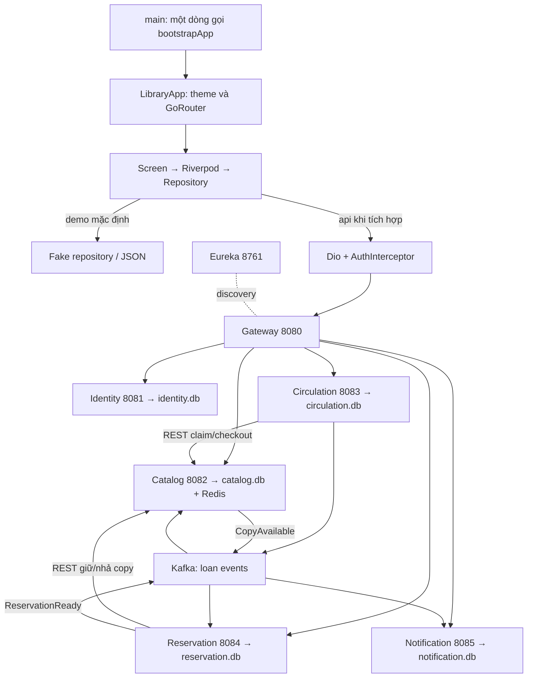

# Library Management — quy ước chung
Contract **LM-1.1.1**. Thiết kế đích; chi tiết task/class/hàm nằm ở file cá nhân.

## 1. Cách làm việc
Người dùng đính kèm **file tổng + file cá nhân** vào chat, không cần đặt trong source.
Tự tìm ANDROID_ROOT qua pubspec.yaml, SERVER_ROOT qua các module Maven; không cố định tên folder/ổ đĩa.
**Trước khi code:** đọc SERVER_ROOT/continue.md (gốc MSS, cùng cấp services), cả bảy phần; kiểm tra source/branch/dirty state.
**Cuối phiên:** thay nội dung đúng block mình, giữ marker và sáu block khác. Ghi task, đã làm, file/hàm/API/migration, test, lỗi/dependency, bước tiếp theo và commit. Giữ vấn đề chưa giải quyết trong bản mới.

## 2. Luồng chạy

Android đang fake data để demo. Fake/remote cùng repository interface; chỉ bật API khi được giao tích hợp, không dùng fake fallback khi API lỗi.

## 3. Công nghệ và port
| Phần | Công nghệ | Port |
|---|---|---:|
| Android | Flutter Material 3, Riverpod, GoRouter, Dio, secure storage | Gọi Gateway |
| Discovery | Eureka Server | 8761 |
| Gateway | Spring Cloud Gateway WebFlux, JWT/RBAC, trace ID | 8080 |
| Identity | Spring MVC/Security, BCrypt/JWT, JPA/SQLite/Flyway | 8081 |
| Catalog | Spring MVC/JPA/SQLite/Flyway, Redis Cache, Kafka inventory | 8082 |
| Circulation | MVC/JPA/SQLite/Flyway, OpenFeign, Kafka/outbox/scheduler | 8083 |
| Reservation | MVC/JPA/SQLite/Flyway, OpenFeign, Kafka/outbox/scheduler | 8084 |
| Notification | MVC/JPA/SQLite/Flyway, Kafka; FCM khi có config | 8085 |
| Redis | Cache Catalog | 6379 |
| Kafka | Host / container listener | 9092 / 29092 |

Java 21; Mẫn pin Boot/Cloud theo build đã kiểm chứng. Gateway không có DB. Emulator: http://10.0.2.2:8080; máy thật: LAN_IP:8080; container dùng service DNS.
Dart config: DATA_MODE=demo|api (mặc định demo), API_BASE_URL. Server config: DB_PATH, EUREKA_URL, REDIS_HOST/PORT, KAFKA_BOOTSTRAP_SERVERS, JWT keys/issuer/audience. DB_PATH do launcher resolve, không phụ thuộc thư mục đứng khi chạy.

## 4. Phân tầng
Android: main → bootstrap → LibraryApp; bootstrap tạo dependency, App chỉ theme/router. Feature có domain/entities,repositories; data/dto,datasources,repositories; presentation/providers,screens,widgets. Core giữ network/auth/config/routing/error. Screen không tự HTTP/đọc JSON.
Server: Controller → Service → Repository/Client; DTO/mapper tách entity. Reuse package/entity hiện có, không tạo trùng bảng. Service giữ business rule/transaction.
Lưu ý code hiện tại: entity Catalog Long ID lệch SQL TEXT; Author biography/nationality lệch bio/country; BookCopy lệch tên cột; page_count chưa có V1. Owner sửa mapping/migration đúng trước CRUD.

## 5. REST và DTO
Gateway giữ /api. JWT subject quyết định user; không tin role/userId do client tự khai.
Envelope: {status,message,data,timestamp,traceId}; lỗi thêm code,fieldErrors. List data: {items,page,size,totalElements,totalPages}; page=0, size=20, max=100.
Create 201, read/update/action 200, delete 204. Lỗi: 400 validation, 401 auth, 403 role, 404 absent, 409 conflict, 503 dependency.

| Route | Method/body chính | Quyền |
|---|---|---|
| /api/auth/register,login,refresh,logout | POST; credentials hoặc refreshToken | Public route; validate token khi cần |
| /api/users/me | GET/PUT profile, không đổi role | Self |
| /api/users[/id] | CRUD; PATCH /id/status | ADMIN |
| /api/books[/id] | CRUD; q,authorId,categoryId,publisherId,page,size | Read authenticated; write staff |
| /api/authors, /api/categories, /api/publishers | GET/POST; GET/PUT/DELETE /id | Như Books |
| /api/books/id/copies; /api/copies/by-qr/value | GET/POST copies; GET QR | Staff |
| /api/loans/requests; /api/loans/me | POST {bookId}; GET list | MEMBER/self |
| /api/loans; /api/loans/id | GET staff list; GET owner detail | Staff/owner |
| /api/loans/id/approve,reject,checkout,return,renew | POST; reject {reason}; checkout {copyId}; return {copyId,condition} | Staff; renew owner/staff |
| /api/reservations | POST {bookId}; GET /me; DELETE /id; POST /id/fulfill | Owner; fulfill staff |
| /api/notifications | GET; GET /unread-count; PATCH /id/read hoặc /read-all | Self |
| /api/notifications/device-tokens | POST {token,platform}; DELETE /id | Self |

Staff = LIBRARIAN/ADMIN. IDs String UUID; giờ UTC ISO-8601.
BookInput: title,isbn,authorIds,categoryIds,publisherId,description,publicationYear,language,pageCount,coverUrl,status. Response thêm id, authors/categories [{id,name}], publisher {id,name}, totalCopies,availableCopies. Quantity tính từ physical copies, không do client sửa.
Author: name,bio,birthDate,country,status; Category: name,description,parentId,status; Publisher: name,address,email,phone,website,status.
Session: accessToken,refreshToken,tokenType,expiresIn,user; User: id,email,fullName,phone,avatarUrl,roles,status. Không trả password/hash. Loan: id,userId,status,items[{bookId,copyId,itemStatus}],dueAt,renewCount. Reservation: id,userId,bookId,status,queuePosition,expiresAt. Notification: id,title,body,isRead,referenceType,referenceId.
JWT bất đối xứng: Identity giữ private key; Gateway/services kiểm chữ ký/issuer/audience/expiry. Access 15 phút; refresh 7 ngày, hash+rotation. Client single-flight refresh, retry request gốc một lần. Register luôn MEMBER.

## 6. Database và nghiệp vụ
SQLite chỉ ở năm stateful services, mỗi service một file; không cross-file FK/JOIN. Flyway append-only version timestamp tăng, ddl-auto=none; foreign_keys ON, WAL, busy_timeout=5000, pool một connection cho demo. Không sửa V1 đã apply/baseline tự động DB cũ.
Borrow: REQUESTED → APPROVED giữ copy RESERVED → checkout BORROWED + due 14 ngày → RETURNED. Renew một lần +7 ngày, chặn overdue/WAITING reservation.
Internal /internal/** không expose Gateway; service credential riêng. Catalog có availability, claim, checkout, release, transfer-holder. Command có operationId/expectedHolderId; conditional update tránh trùng copy, retry idempotent.
Không giữ SQLite transaction khi chờ HTTP; cross-service failure dùng operation record, bù và reconciler. Return ghi loan+outbox; Catalog nhả đúng holder rồi phát CopyAvailable; Reservation mới giữ copy cho đầu queue. READY hold 24h. Fulfill chuyển holder sang loan trước khi xác nhận hoàn tất.
Workflow retry dùng Idempotency-Key theo actor+operation; cùng key/payload trả kết quả cũ, khác payload trả 409.

## 7. Kafka và Redis
Topics: library.loan.approved.v1 (Circulation→Notification), library.loan.returned.v1 (→Catalog,Notification), library.loan.overdue.v1 (→Notification), library.copy.available.v1 (Catalog→Reservation), library.reservation.ready.v1 (Reservation→Notification).
Envelope: eventId,type,schemaVersion,occurredAt,traceId,aggregateId,aggregateVersion,payload. Payload mang loanId/reservationId,userId,bookId,copyId và thời gian liên quan; không gửi entity/token.
Outbox cùng transaction nghiệp vụ; publish chờ ack rồi mark. Consumer dedup (consumer,eventId) cùng transaction, group riêng, retry hữu hạn rồi DLT. Không giả định ordering xuyên topic.
Redis detail key catalog:book:detail:{id}, list catalog:book:list:{queryHash}; TTL 300s, evict sau commit khi CRUD/copy/quan hệ đổi. Redis lỗi đọc SQLite; claim không dựa cache; không KEYS *.

## 8. Owner và nghiệm thu
Khang: Book/network/bootstrap/cache/OpenAPI/inventory. Trí: Author/Circulation/state. Trọng: Auth/Category/theme/router. Toàn: Publisher server/Reservation/Notification/Kafka contract. Hiếu: User/profile/home/Gateway RBAC/audit. Duy Khang: Publisher client/QR/reservation/notification UI. Mẫn: build/Compose/discovery/Gateway routing/ports.
Shared file có một owner merge chính; User/Role Hiếu giữ, Auth Trọng dùng chung. Không sửa cả service người khác.
Test theo phạm vi: demo offline, mapper/CRUD, refresh, concurrent claim, event redelivery. Trong continue.md phân biệt demo-ready/api-ready/integrated/verified và fake với thành phần thật.
Đổi contract phải thông báo owner ảnh hưởng, cập nhật file tổng và gửi lại các chat. File đính kèm không tự đồng bộ. Không tự đổi port/DTO hoặc force-push.

