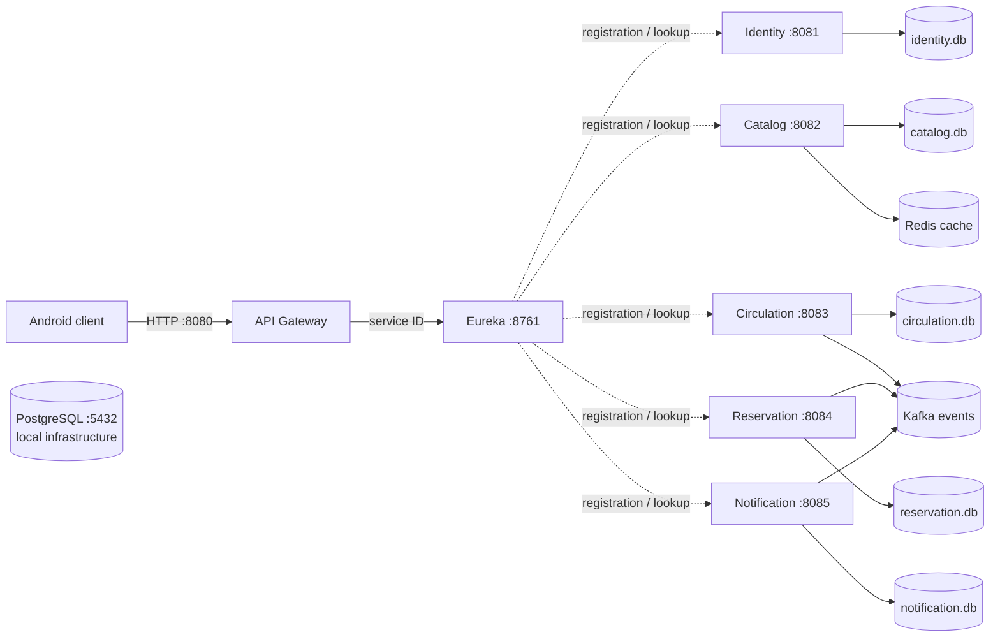

# ADR-001: Service boundaries and data ownership

- **Status:** Accepted as the current team contract
- **Scope:** MSS-001 infrastructure boundary and persistence rules
- **Date:** 2026-11-04

## Decision

The backend is a set of independently runnable services behind one API Gateway. Eureka provides service discovery. Each domain service owns its code, API and persistence. No service imports another service's entity or repository; identifiers crossing a service boundary are UUID/string references rather than database foreign keys.

Each stateful service owns exactly one private SQLite database file, managed by that service's Flyway migrations. No cross-service database file or foreign key is permitted. PostgreSQL may run as local shared infrastructure under MSS-005, but the services must not use it as their data store. Redis is a cache, never the system of record. Kafka is for asynchronous side effects; a command requiring an immediate answer remains synchronous. Event ownership and topic names follow the team contract (`library.loan.approved.v1`, `library.loan.returned.v1`, `library.loan.overdue.v1`, `library.reservation.ready.v1`).

## Consequences

- Service ports and names are canonical and independently configurable through Compose.
- PostgreSQL is available as an MSS-005 infrastructure component; domain services remain backed by their owned SQLite files unless the team contract is explicitly changed.
- `renting-sevice` is excluded from the Maven reactor pending an explicitly approved cleanup.
- Schema changes stay with each domain owner and are append-only. Infrastructure work does not add domain tables or migrations.
